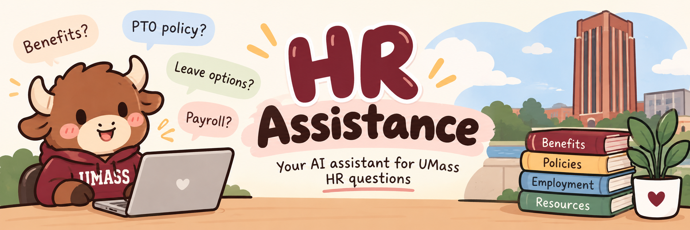

# HR Assistance
An AI Assistance for people who want to find answers to HR questions using official UMass documentation.

## Table of Contents

- [Install](#install)
- [Usage](#usage)
- [How It Works](#how-it-works)
- [Project Structure](#project-structure)
- [Adding PDF Documents](#adding-pdf-documents)
- [Configuration](#configuration)
- [Known Limitations](#known-limitations)
- [API](#api)
- [Maintainers](#maintainers)
- [Credits](#credits)

## Install

### Dependencies

You will need:

- Python 3 and `pip` (`python3 --version` and `python3 -m pip --version` to check)
- Git (`git --version` to check)
- A Google Gemini API key from [Google AI Studio](https://aistudio.google.com/app/apikey)

### 1. Get the project

```bash
git clone https://github.com/datnguyen-en/HR_Assistance
cd umass-hr-chatbot
```

### 2. Install the Python dependencies

```bash
python3 -m venv venv
source venv/bin/activate
python3 -m pip install -r requirements.txt
```

On Windows, activate the environment with `venv\Scripts\activate` instead.

### 3. Configure the project

Copy the example environment file:

```bash
cp .env.example .env
```

Then add your own key and source URL to `.env`:

```dotenv
GEMINI_API_KEY=your-gemini-api-key-here
SOURCE_URLS=https://www.umass.edu/hr/
```

Do not commit your `.env` file or API key to GitHub.

### 4. Verify the installation

Check that the required packages can be imported:

```bash
python3 -c "import chromadb, streamlit, sentence_transformers; print('Dependencies installed')"
```

Expected output if those imports succeed:

```text
Dependencies installed
```

This checks the Python environment; it does **not** confirm that Gemini credentials or HR document ingestion are working.

## Usage

### CLI

**1. Process the HR documents**

Run the ingestion script to collect and process source documents:

```bash
python3 ingestion/ingest.py
```

The system collects and processes HR documents, then saves the information so the chatbot can search for answers later. Once the process is finished, you can check the data/chroma/ folder to see if the files were created successfully.

**2. Start the chatbot**

```bash
streamlit run ui/app.py
```

Streamlit normally displays a local URL similar to:

```text
Local URL: http://localhost:8501
```

Open the URL in your browser to use the chatbot.

**3. Ask a question**

For example, enter:

```text
What benefits are available for UMass employees?
```

The chatbot searches the ingested documents and generates an answer using the relevant information. When available, it also includes source citations so you can review the original HR documentation. The exact response depends on the documents in the database.

**4. If something goes wrong**

If the app cannot answer questions because the vector database is empty, run the ingestion script before starting the chatbot:

```bash
python3 ingestion/ingest.py
streamlit run ui/app.py
```

If Gemini authentication fails, check that `GEMINI_API_KEY` in `.env` is set to your real key, then restart the app.

## How It Works

1. **Ingestion:** The system collects HR web pages and PDF documents, then converts their content to .MD file, and then it seperates the text into chunks (a bunch of texts - for easier terminology), and creates embeddings (it convert "THAT" bunch of texts to number so that machine could understand).
2. **Retrieval:** When someone asks a question, ChromaDB searches for relevant document chunks using semantic similarity (like when you are searching something on Google, it shows the results that similar base on your words).
3. **Response:** The retrieved content is sent to Google Gemini to generate an answer that follows in the source documents, with citations where available.

## Project Structure

```text
umass-hr-chatbot/
├── ingestion/
│   ├── ingest.py          # Runs the ingestion pipeline
│   ├── scraper.py         # Collects HR web pages
│   ├── pdf_processor.py   # Converts PDFs to Markdown
│   ├── chunker.py         # Splits text into chunks
│   ├── embedder.py        # Creates embeddings
│   └── vector_store.py    # Stores data in ChromaDB
├── retrieval/
│   ├── retriever.py       # Finds relevant documents
│   └── llm_client.py      # Communicates with Gemini
├── ui/
│   └── app.py             # Streamlit chatbot interface
├── data/
│   ├── raw/               # Source documents
│   └── chroma/            # Local vector database
├── config.py              # Reads configuration
├── models.py              # Shared data models
├── .env.example           # Environment variable template
├── requirements.txt       # Python dependencies
└── README.md
```

## Adding PDF Documents

Place HR PDF files in `data/raw/` before running the ingestion pipeline:

```bash
python3 ingestion/ingest.py
```

## Configuration

Settings are stored in `.env`.

| Variable | Default | Description |
| --- | --- | --- |
| `GEMINI_API_KEY` | Required | Google Gemini API key |
| `LLM_MODEL` | `gemini-1.5-flash` | Gemini model name |
| `SOURCE_URLS` | Required | Comma-separated HR URLs |
| `CHUNK_SIZE` | `700` | Tokens per text chunk |
| `OVERLAP_PCT` | `0.12` | Overlap between chunks |
| `TOP_K` | `5` | Number of retrieved chunks |
| `RAW_DATA_DIR` | `data/raw` | Folder for source files |
| `CHROMA_DIR` | `data/chroma` | Local vector database folder |


## Known Limitations

- The chatbot can only search documents that have already been processed by the ingestion pipeline.
- If a source page changes, the locally stored content may be outdated until ingestion runs again.
- AI-generated responses may be inaccurate, so make sure you double check the original HR documents before making important decisions.

## API

The project uses Python modules to process HR documents, find relevant information, and generate answers to user questions. Developers can use these modules to understand how the chatbot works and add new features to the project.

### Python Module Reference

| Module | Purpose | Public API to document |
| --- | --- | --- |
| `ingestion/scraper.py` | Collect HR website content | Function that accepts source URLs and returns collected content |
| `ingestion/pdf_processor.py` | Read HR PDF content | Function that accepts a PDF path and returns processed text |
| `ingestion/chunker.py` | Divide documents into text chunks | Function that accepts text and chunk settings and returns chunks |
| `ingestion/embedder.py` | Convert text to embeddings | Function that accepts text chunks and returns embeddings |
| `ingestion/vector_store.py` | Store and query embeddings | Public storage and search methods |
| `retrieval/retriever.py` | Retrieve relevant document chunks | Function or class used to search the database |
| `retrieval/llm_client.py` | Generate an answer with Gemini | Public function or class used to generate responses |

### Public Functions and Examples

The project provides three main functions for processing HR documents, searching for information, and generating AI responses.

**`IngestionPipeline().run()`**

Collects HR documents from websites and PDFs, breaks them into smaller chunks, and stores them in ChromaDB for searching.

- **Returns:** `IngestionSummary` with information about the ingestion process.

**`Retriever(embedder, vector_store, k=5).retrieve(query)`**

Searches the stored documents and finds the most relevant information based on the user's question.

- `query`: The question you want to search for.
- `k`: Number of document chunks to retrieve (default: 5).
- **Returns:** A list of `RetrievedChunk`, or an empty list if no documents are available.

**`LLMClient(model, api_key).generate(query, context_chunks)`**

Sends the user's question and relevant documents to your LLM to generate an AI response.

- `query`: The user's question.
- `context_chunks`: Relevant documents retrieved from ChromaDB.
- **Returns:** `LLMResponse` containing the generated answer and source citations.
- **Raises:** `LLMError` if the API request fails.

### Example Usage

The following example searches for UMass HR information and generates an AI response.

```python
query = "What is the PTO policy?"

retriever = Retriever(Embedder(), VectorStore("data/chroma"))
chunks = retriever.retrieve(query)

client = LLMClient("gemini/flash-2.5", "your-key")
response = client.generate(query, chunks)

print(response.answer)
```


## Maintainers

- **[Eric Nguyen](https://github.com/datnguyen-en)** — Vibe Coder 

## Credits

- [UMass Human Resources](https://www.umass.edu/hr/) — HR documentation used as a source of information.
- [Google AI Studio](https://aistudio.google.com/) — Gemini API documentation and key setup.
- Adi and Adhya — Peer review feedback for my README :D.
