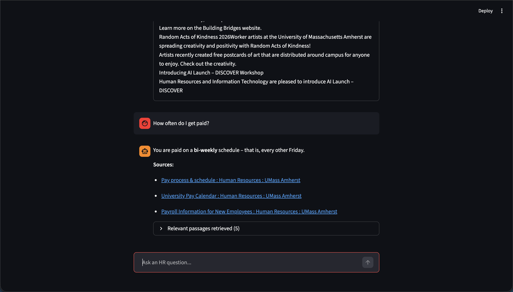

# HR Assistance

An AI-powered chatbot that helps users find answers to HR questions using official UMass documentation.

## Table of Contents

- [Install](#install)
- [Usage](#usage)
- [How It Works](#how-it-works)
- [Project Structure](#project-structure)
- [Adding PDF Documents](#adding-pdf-documents)
- [Configuration](#configuration)
- [Known Limitations](#known-limitations)
- [API](#api)
- [Maintainers](#maintainers)
- [Credits](#credits)

## Install

### Dependencies

You will need:

- Python 3 and `pip` (`python3 --version` and `python3 -m pip --version` to check)
- Git (`git --version` to check)
- A Groq API key from [Groq AI Studio](https://groq.com/)

### 1. Get the project

```bash
git clone https://github.com/datnguyen-en/HR_Assistance.git
cd HR_Assistance
```

### 2. Install the Python dependencies

```bash
python3 -m venv venv
source venv/bin/activate
python3 -m pip install -r requirements.txt
```

On Windows, activate the environment with `venv\Scripts\activate` instead.

### 3. Configure the project

Copy the example environment file:

```bash
cp .env.example .env
```

Then add your own key and source URL to `.env`:

```dotenv
GEMINI_API_KEY=your-gemini-api-key-here
SOURCE_URLS=https://www.umass.edu/hr/
```

Do not commit your `.env` file or API key to GitHub.

### 4. Verify the installation

Check that the required packages can be imported:

```bash
python3 -c "import chromadb, streamlit, sentence_transformers; print('Dependencies installed')"
```

Expected output if those imports succeed:

```text
Dependencies installed
```

This checks the Python environment; it does **not** confirm that Groq credentials or HR document ingestion are working.

## Usage

### CLI

Before proceeding, make sure you are in the project root
directory (`HR_Assistance/`) and your virtual environment
is activated.

**1. Process the HR documents**

In your terminal, run the ingestion script to collect and process source documents:

```bash
python3 ingestion/ingest.py
```

Example output:

```text
INFO Processed PDF: test.pdf (12 chunks)
INFO Embedding 356 chunks...
Batches: 100% | 12/12
INFO Ingestion complete: 80 documents processed, 356 chunks stored, 1 failures.
```

The output displays the number of documents processed,
text chunks stored, and any failures encountered during
ingestion.

If individual sources fail, the system continues processing
the remaining documents. Review the warning messages
to identify any failed sources.

The actual output may vary depending on the source
documents.

Once ingestion is complete, check the `data/chroma/`
directory to verify that the local vector database
has been created.

**2. Start the chatbot**

After ingestion finishes, run the following command in the same terminal:

```bash
streamlit run ui/app.py
```

You can now view your Streamlit app in your browser:

```text
Local URL: http://localhost:8501
```

Open the URL in your browser to use the chatbot.

**3. Ask a question**

For example, enter:

```text
What benefits are available for UMass employees?
```

The chatbot searches the ingested documents and generates an answer using the relevant information. When available, it also includes source citations so you can review the original HR documentation. The exact response depends on the documents in the database.



*Figure 1. The HR Assistant answering an employee's question
using UMass HR documentation.*

**4. If something goes wrong**

If the app cannot answer questions because the vector database is empty, run the ingestion script before starting the chatbot:

```bash
python3 ingestion/ingest.py
streamlit run ui/app.py
```

If Groq authentication fails, check that GROQ_API_KEY in .env contains a valid API key, then restart the app.

## How It Works

1. **Ingestion:** The system collects HR web pages and PDF
   documents, converts them into Markdown, and divides the
   content into smaller sections called chunks. These chunks
   are then converted into numerical representations called
   embeddings.

2. **Retrieval:** When a user asks a question, ChromaDB
   searches for the most relevant document chunks based on
   their meaning, rather than relying only on exact keywords.

3. **Response:** The retrieved content is sent to an LLM
   through the Groq API to generate an answer based on the
   source documents. Relevant sources are also provided so
   users can review the original HR documentation.

## Project Structure

```text
HR_Assistance/
├── ingestion/
│   ├── ingest.py          # Runs the ingestion pipeline
│   ├── scraper.py         # Collects HR web pages
│   ├── pdf_processor.py   # Converts PDFs to Markdown
│   ├── chunker.py         # Splits text into chunks
│   ├── embedder.py        # Creates embeddings
│   └── vector_store.py    # Stores data in ChromaDB
├── retrieval/
│   ├── retriever.py       # Finds relevant documents
│   └── llm_client.py      # Communicates with Groq
├── ui/
│   └── app.py             # Streamlit chatbot interface
├── data/
│   ├── raw/               # Source documents
│   └── chroma/            # Local vector database
├── assets/
│   ├── banner.png
│   └── chatbot-demo.png
├── sources.txt            # HR source URLs
├── config.py              # Reads configuration
├── models.py              # Shared data models
├── .env.example           # Environment variable template
├── requirements.txt       # Python dependencies
└── README.md
```

## Adding PDF Documents

Place HR PDF files in `data/raw/` before running the ingestion pipeline:

```bash
python3 ingestion/ingest.py
```


## Configuration

Settings are stored in `.env`. The source URLs are listed in
`sources.txt` by default.

| Variable | Default | Description |
| --- | --- | --- |
| `GROQ_API_KEY` | Required | Groq API key |
| `LLM_MODEL` | `openai/gpt-oss-120b` | Groq model name |
| `SOURCES_FILE` | `sources.txt` | File containing HR source URLs |
| `SOURCE_URLS` | Optional | Additional comma-separated HR URLs |
| `CHUNK_SIZE` | `700` | Tokens per text chunk |
| `OVERLAP_PCT` | `0.12` | Fraction of overlap between chunks |
| `TOP_K` | `5` | Maximum number of retrieved chunks |
| `RAW_DATA_DIR` | `data/raw` | Folder for source documents |
| `CHROMA_DIR` | `data/chroma` | Local vector database folder |


## Known Limitations

- The chatbot can only search documents that have already been processed by the ingestion pipeline.
- If a source page changes, the locally stored content may be outdated until ingestion runs again.
- AI-generated responses may be inaccurate, so make sure you double check the original HR documents before making important decisions.

## API

The project uses Python modules to process HR documents, find relevant information, and generate answers to user questions. Developers can use these modules to understand how the chatbot works and add new features to the project.

### Python Module Reference

| Module | Purpose | Public API |
| --- | --- | --- |
| `ingestion/scraper.py` | Collect HR website content | `Scraper.fetch_and_convert(url)` |
| `ingestion/pdf_processor.py` | Read HR PDF content | `PDFProcessor.process(pdf_path)` |
| `ingestion/chunker.py` | Divide documents into text chunks | `Chunker.chunk(text, metadata)` |
| `ingestion/embedder.py` | Convert text to embeddings | `Embedder.embed(text)` |
| `ingestion/vector_store.py` | Store and search embeddings | `VectorStore.upsert(chunks, embeddings)`, `VectorStore.query(query_embedding, k)` |
| `retrieval/retriever.py` | Retrieve relevant documents | `Retriever.retrieve(query)` |
| `retrieval/llm_client.py` | Generate an AI response | `LLMClient.generate(query, context_chunks)` |

### Public Functions and Examples

The project provides three main functions for processing HR documents, searching for information, and generating AI responses.

**`IngestionPipeline().run()`**

Collects HR documents from websites and PDFs, breaks them into smaller chunks, and stores them in ChromaDB for searching.

- **Returns:** `IngestionSummary` with information about the ingestion process.

**`Retriever(embedder, vector_store, k=5).retrieve(query)`**

Searches the stored documents and finds the most relevant information based on the user's question.

- `query`: The question you want to search for.
- `k`: Number of document chunks to retrieve (default: 5).
- **Returns:** A list of `RetrievedChunk`, or an empty list if no documents are available.

**`LLMClient(model, api_key).generate(query, context_chunks)`**

Sends the user's question and relevant documents to your LLM to generate an AI response.

- `query`: The user's question.
- `context_chunks`: Relevant documents retrieved from ChromaDB.
- **Returns:** `LLMResponse` containing the generated answer and source citations.
- **Raises:** `LLMError` if the API request fails.


### Example Usage

The following example demonstrates how developers can
retrieve HR information and generate an AI response
using the project's Python API.

Before running this example, complete the installation
and ingestion steps. Run the Python code from the
project root directory.

```python
from config import load_config
from ingestion.embedder import Embedder
from ingestion.vector_store import VectorStore
from retrieval.retriever import Retriever
from retrieval.llm_client import LLMClient

config = load_config()

query = "What is the PTO policy?"

retriever = Retriever(
    Embedder(),
    VectorStore(config.chroma_dir),
    k=config.top_k
)

chunks = retriever.retrieve(query)

if chunks:
    client = LLMClient(
        config.llm_model,
        config.groq_api_key
    )

    response = client.generate(query, chunks)
    print(response.answer)

    print("\nSources:")
    for citation in response.citations:
        print(citation.source)
else:
    print("No documents found. Run ingestion first.")
```

The example retrieves relevant HR documents, generates
an answer, and prints the associated sources. If no
documents are available, it reminds the developer to
run the ingestion pipeline first.


## Maintainers

- **[Eric Nguyen](https://github.com/datnguyen-en)** — Vibe Coder 

## Credits

- [UMass Human Resources](https://www.umass.edu/hr/) — HR documentation used as a source of information.
- [Groq AI Studio](https://groq.com/) — Groq API documentation and key setup.
- Adi and Adhya — Peer review and feedback for my README :D.
- Prof. Meï and TA Zoe Moccia — For their valuable feedback and guidance throughout the process of learning how to write clear, effective, and maintainable README documentation.
